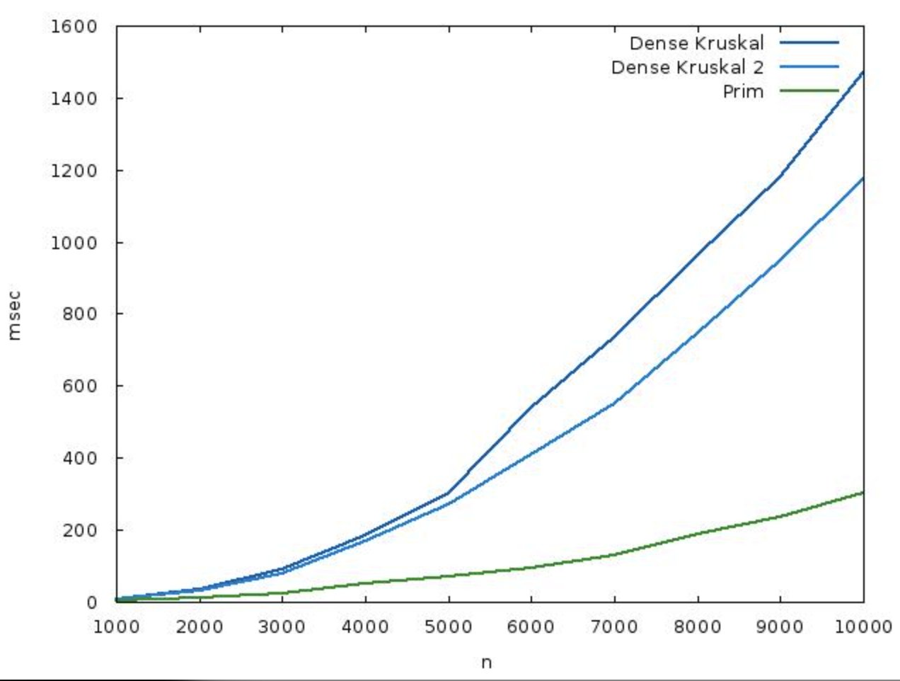
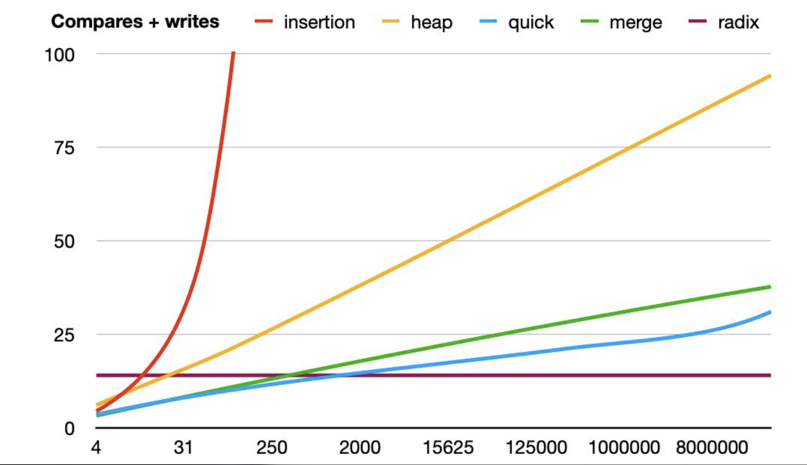

# Assignment 3 — Smart City Infrastructure and Route Planning

**Name:** Khanzada Nyshanbek Adylqyzy  
**Group:** SE-2539  
**Project:** Asik3_DAA  
**Language:** Java

## 1. Overview

The project models the infrastructure of a smart city as a graph and implements the graph algorithms needed for infrastructure planning, connectivity analysis and route planning.

| City concept | Graph concept |
|---|---|
| district / location | vertex |
| road or infrastructure connection | edge |
| construction cost or travel distance | edge weight |
| one-way road or dependency between services | directed edge |

The system solves three groups of tasks:

1. **Infrastructure planning** – find the cheapest network that connects all districts (Minimum Spanning Tree with Kruskal's and Prim's algorithms) and detect whether the network is connected.
2. **Connectivity analysis** – find an order of dependent services (topological ordering, with cycle detection) and the groups of locations that can reach each other (Strongly Connected Components).
3. **Route planning** – find shortest distances and routes from a chosen district to all others (Dijkstra's algorithm), and shortest paths in acyclic graphs (DAG shortest path, an extra algorithm of this project).

**Graph representation.** Graphs are stored as **adjacency lists**: for every vertex a list of its outgoing edges (target vertex and weight). For undirected graphs every edge is stored in the lists of both endpoints. The space is O(V + E), going through the neighbours of a vertex costs O(degree), and the representation is efficient for sparse graphs such as the ones used here (E = 3V to 5V). An adjacency matrix would need O(V²) memory.

## 2. Implementation

| Component | Implementation and design decisions |
|---|---|
| **Disjoint Set Union** | Arrays `parent` and `size`. `find()` uses **path compression**; `union()` uses **union by size** (the smaller tree is attached below the larger one). `union()` returns whether two different sets were merged, which is exactly the "does this edge create a cycle?" check that Kruskal needs. |
| **Kruskal's algorithm** | Sorts all edges by weight and goes through them in this order; an edge is accepted if its endpoints are in different DSU sets. The result contains the edges of the tree, the **total weight** and whether the graph is **connected** (a spanning tree has V − 1 edges). |
| **Prim's algorithm** | Grows one tree from a start vertex. A **priority queue** always returns the cheapest edge that leaves the tree; edges leading to vertices already in the tree are skipped. Returns the total weight and the connectivity flag in the same way as Kruskal's algorithm, so the two results can be compared directly. |
| **Topological ordering** | **Kahn's algorithm**: repeatedly remove vertices with in-degree 0 and decrease the in-degree of their neighbours. If fewer than V vertices were removed, the graph contains a cycle and no topological order exists; this is reported explicitly. |
| **Strongly connected components** | **Kosaraju's algorithm**: a first DFS records the finishing order, the graph is reversed, and a second DFS in reverse finishing order collects one component per search. Every vertex ends up in exactly one component. |
| **Dijkstra's algorithm** | Priority queue; distance array initialised to infinity; a `previous` array is used to reconstruct the path. Unreachable vertices keep an infinite distance and an empty path. It is meant for **non-negative** edge weights (see section 3 for the reason). |
| **DAG shortest path** | Computes a topological order first and then relaxes the outgoing edges of every vertex in this order. Works in linear time and also with negative weights, because a DAG has no cycles. |
| **Benchmark** | Generates graphs with a fixed seed, runs every algorithm five times, measures time with `System.nanoTime()`, counts operations and writes the results to CSV files. |

The source code is organised into classes for graph representation, DSU, minimum spanning trees, connectivity algorithms, shortest-path algorithms, graph generation and benchmarking. The test class checks representative edge cases, while `Main` is the entry point for running the project.

## 3. Complexity Analysis

**Assumptions.** V is the number of vertices and E the number of edges. Graphs are stored as adjacency lists; the priority queue is a binary heap; since E ≤ V², log E = O(log V). α is the inverse Ackermann function (α(n) ≤ 4 for any realistic n).

| Algorithm | Time | Extra space | How V and E affect the cost |
|---|---|---|---|
| **DSU `find` / `union`** (path compression + union by size) | amortised **O(α(n))** per operation | O(n) (`parent`, `size`) | Practically constant per operation, almost independent of the number of elements. Without the optimisations a `find` can cost O(n) (a long chain); union by size alone gives O(log n). |
| **Kruskal** | **O(E log E) = O(E log V)** – the sort dominates; the DSU part is O(E · α(V)) | O(V + E) (sorted edges + DSU) | Cost is driven by **E** (sorting). V only influences the DSU and the logarithm. |
| **Prim** (adjacency list + binary heap) | **O((V + E) log V)**; O(E log V) for connected graphs | O(V + E) (the heap may hold up to E edges) | Every edge is added to the heap at most once, so cost grows with **E**; the logarithm depends on the heap size. For a very dense graph an adjacency-matrix version with O(V²) can be better. |
| **Topological ordering** (Kahn) | **O(V + E)** | O(V) | Every vertex is removed once and every edge is processed once: linear in the size of the graph. |
| **SCC** (Kosaraju) | **O(V + E)** | O(V + E) (the reversed graph) + O(V) for the DFS stack | Two DFS traversals and one graph reversal, each O(V + E): linear in V + E, about twice the work of a single traversal. |
| **Dijkstra** (binary heap) | **O((V + E) log V)** | O(V + E) | The edge scans grow with **E**; the heap work grows with the number of successful distance updates (at most E) and with log V. |
| **DAG shortest path** | **O(V + E)** | O(V) | Topological order (O(V + E)) and one relaxation per edge. |

**Why Dijkstra's algorithm is unsuitable for graphs with negative edge weights.** Dijkstra fixes the distance of a vertex at the moment it is removed from the priority queue. This is correct only if no later path can be shorter, which holds when every edge adds a non-negative amount. A negative edge breaks this assumption. Example: edges 0→1 (weight 2), 0→2 (weight 5) and 2→1 (weight −4). Dijkstra finalises vertex 1 with distance 2 and never looks at it again, but the path 0→2→1 has length 5 − 4 = 1. A negative cycle makes shortest paths undefined. For graphs with negative weights Bellman-Ford (O(V · E)) is used, and for acyclic graphs the DAG shortest-path algorithm works because each edge is relaxed after the final distance of its start vertex is known.

## 4. Experimental Setup

**Graph sizes** (as required by the assignment):

| Name | Vertices (V) | Edges (E) |
|---|---:|---:|
| Small | 10 | 30 |
| Medium | 100 | 500 |
| Large | 1,000 | 5,000 |

**Graph generation.** The benchmark uses generated weighted graphs with the sizes listed below. Exact reproducibility depends on the seed and weight range configured in the graph generator; those values should be documented from the implementation if they are part of the submitted experiment.

| Graph type | Used for | How it is generated | Contains cycles? |
|---|---|---|---|
| Undirected, **connected** | Kruskal, Prim, Dijkstra | Generated by the project graph generator. The exact construction procedure should be taken from `GraphGenerator` if further implementation-level detail is required. | Contains undirected cycles when extra edges are present |
| Directed **acyclic** (DAG) | Topological ordering, SCC, DAG shortest path | Generated as a directed acyclic graph for algorithms that require or analyse a DAG. The precise edge-generation rule is implementation-specific. | **No** |
| Directed **with cycles** | Topological ordering (cycle detection), SCC | This graph type is relevant for checking cycle detection and SCC behaviour. A separate benchmark table for this graph type is not included in the results below. | **Yes** |

**Measurement procedure.** Every experiment is repeated **5 times**; the time of one run is measured with `System.nanoTime()` and the **average** of the 5 runs is recorded. Graph generation is not included in the measured time. The benchmark writes three CSV result files: `mst_results.csv`, `connectivity_results.csv` and `shortest_path_results.csv`. Their exact output directory is determined by the path configured in the project; update this README if the files are moved into a `results/tables/` folder.

**Operation counters.** These are implementation-defined counters, not a universal measure shared by every algorithm. The observed values are consistent with Prim and Dijkstra counting adjacency entries processed (2E for the undirected graphs), and topological sort, SCC and DAG shortest path counting V + E work units. Kruskal's counter includes more than one kind of work, because it can exceed E; it must not be interpreted as simply the number of edges examined. For an exact definition, consult the counter increments in each algorithm's source code.

## 5. Results

All times are the average of 5 runs measured with `System.nanoTime()` and are shown in microseconds (µs; 1 µs = 1,000 ns). The raw values in nanoseconds are in the CSV files.

### 5.1 Minimum spanning tree: Kruskal vs Prim

| Graph | V | E | Algorithm | Time (µs) | Operations | MST weight | Connected |
|---|---:|---:|---|---:|---:|---:|---|
| Small | 10 | 30 | Kruskal | 5.2 | 31 | 265 | true |
| Small | 10 | 30 | Prim | 5.4 | 60 | 265 | true |
| Medium | 100 | 500 | Kruskal | 56.9 | 625 | 1186 | true |
| Medium | 100 | 500 | Prim | 63.5 | 1000 | 1186 | true |
| Large | 1000 | 5000 | Kruskal | 608.7 | 9952 | 12683 | true |
| Large | 1000 | 5000 | Prim | 579.3 | 10000 | 12683 | true |

### 5.2 Topological ordering and SCC

| Graph | V | E | Algorithm | Time (µs) | Operations |
|---|---:|---:|---|---:|---:|
| Small | 10 | 30 | Topological sort | 7.2 | 40 |
| Small | 10 | 30 | SCC | 10.4 | 40 |
| Medium | 100 | 500 | Topological sort | 59.5 | 600 |
| Medium | 100 | 500 | SCC | 89.6 | 600 |
| Large | 1000 | 5000 | Topological sort | 450.6 | 6000 |
| Large | 1000 | 5000 | SCC | 604.1 | 6000 |

These rows were measured on DAGs. A separate cyclic-graph benchmark was not recorded, so no timing or SCC-size values are reported here.

### 5.3 Shortest paths: Dijkstra and DAG shortest path

| Graph | V | E | Algorithm | Time (µs) | Operations |
|---|---:|---:|---|---:|---:|
| Small | 10 | 30 | Dijkstra | 20.6 | 60 |
| Small | 10 | 30 | DAG shortest path | 8.3 | 40 |
| Medium | 100 | 500 | Dijkstra | 121.0 | 1000 |
| Medium | 100 | 500 | DAG shortest path | 70.7 | 600 |
| Large | 1000 | 5000 | Dijkstra | 869.4 | 10000 |
| Large | 1000 | 5000 | DAG shortest path | 241.7 | 6000 |

### 5.4 Plots

The plots were created in Microsoft Excel from benchmark results. In the three test graphs V and E grow together (E = 3V, 5V, 5V), so the plots have similar trends; the effect of V alone and E alone cannot be isolated from these three data points.

## 6. Comparison and Discussion

### 6.1 Kruskal vs Prim

Both algorithms return the same total weight on every graph (265, 1186 and 12683) and both report the graph as connected, as expected for a connected undirected graph.

Kruskal was slightly faster on the Small graph (5.2 vs 5.4 µs) and the Medium graph (56.9 vs 63.5 µs). Prim was slightly faster on the Large graph (579.3 vs 608.7 µs). These differences are modest and may be affected by JVM warm-up and run-to-run variation; the measurements do not establish a universal winner.

The operation counts show how the two algorithms spend their work differently. Prim's count is exactly 2E (60, 1000, 10000), the number of adjacency-list entries scanned, since every undirected edge is seen from both ends. Kruskal's count is lower than 2E for the larger graphs (625 for E = 500 and 9952 for E = 5000), but Kruskal also has to sort all edges, which a simple operation counter does not capture. For this reason operation counts alone cannot predict which algorithm is faster.

Kruskal's measured time grew by about 118× from the Small to the Large graph, while Prim's grew by about 107×. The number of edges grew by about 167×. These timings are individual benchmark results and can be affected by JVM warm-up and machine load.

### 6.2 Disjoint Set Union

The DSU is what makes Kruskal's cycle check cheap. Without optimisations, `find` follows parent pointers up to the root, and unions can build long chains, so one `find` can cost O(n). Two optimisations fix this:

* **Union by size** always attaches the smaller tree below the larger one, so the height of any tree is at most log₂ n and a `find` costs O(log n) even in the worst case.
* **Path compression** makes every vertex visited by `find` point directly to the root, so the following `find` calls on the same vertices cost one step.

Together they give an amortised cost of O(α(n)) per operation, which is why the sorting step, O(E log E), dominates Kruskal's running time and the DSU part is almost linear in E. No separate benchmark comparing optimised and unoptimised DSU was included, so this report makes no experimental claim about the measured speed-up from those optimisations.

### 6.3 Topological ordering and SCC

Both algorithms are O(V + E), and the operation counts confirm this: 40, 600 and 6000 operations for V + E = 40, 600 and 6000. The measured time grew by 62× (topological sort) and 58× (SCC) from the Small to the Large graph, and by 7.6× and 6.7× from the Medium to the Large graph, where V + E grows by 10×. The growth is therefore at most linear in the graph size, as expected.

SCC was 1.3 to 1.5 times slower than topological sorting on every size (10.4 vs 7.2 µs, 89.6 vs 59.5 µs, 604.1 vs 450.6 µs). This is expected: Kosaraju's algorithm needs two depth-first searches and a reversed graph, while Kahn's algorithm needs one pass over the vertices and edges.

On the DAGs used in the table above topological sorting always succeeds and every vertex forms its own strongly connected component. The project includes cycle-detection and SCC tests on a directed graph with a cycle. The benchmark tables above do not include timing measurements for that separate cyclic graph.

### 6.4 Dijkstra vs DAG shortest path

Dijkstra's operation count is 2E (60, 1000, 10000) and the DAG shortest-path algorithm's count is V + E (40, 600, 6000), in line with O((V + E) log V) and O(V + E). The DAG algorithm was faster on every size (8.3 vs 20.6 µs, 70.7 vs 121.0 µs and 241.7 vs 869.4 µs, i.e. 1.7× to 3.6× faster), because it needs only one pass in topological order and no priority queue. The two algorithms ran on different kinds of graphs (connected undirected graphs for Dijkstra, DAGs for the DAG algorithm), so the comparison shows the cost of each method, not the same problem solved twice.

From the Small to the Large graph Dijkstra's time grew by a factor of 42 and the DAG algorithm's by a factor of 29. Vertices that cannot be reached from the source keep an infinite distance and are never expanded, so for graphs that are not fully reachable the running time depends only on the reachable part.

### 6.5 Theory vs experiment

Theory predicts that the time of Kruskal and Prim grows like E log V, and the time of topological sort, SCC and the DAG algorithm like V + E. In these recorded runs, the time per counted operation fell with graph size for each listed algorithm. Since the MST timing values come from a newer run than the connectivity and shortest-path values, compare trends within each algorithm rather than treating all rows as one simultaneous benchmark session:

| Algorithm | ns per operation (Small) | (Medium) | (Large) |
|---|---:|---:|---:|
| Kruskal | 167 | 91 | 61 |
| Prim | 90 | 64 | 58 |
| Topological sort | 180 | 99 | 75 |
| SCC | 260 | 149 | 101 |
| Dijkstra | 343 | 121 | 87 |
| DAG shortest path | 207 | 118 | 40 |

This suggests that in the small graphs a large part of the measured time is fixed overhead (object creation, first calls on a JVM that has not yet compiled the code, timer resolution) and not the algorithm itself; this explanation was not tested separately. For this reason the Small-graph timings should be read only as an order of magnitude, and the Medium → Large step (V and E ×10, operations ×10 for most algorithms) is a useful comparison with theory: time grew by about 7.6× (topological sort), 6.7× (SCC), 10.7× (Kruskal), 9.1× (Prim), 7.2× (Dijkstra) and 3.4× (DAG shortest path). Timing variation means these measurements should be treated as empirical observations rather than proof of asymptotic bounds.

The measurements also depend on the computer, on JVM warm-up and on other running processes, so absolute times will differ on other machines, while the operation counts do not.

## 7. Testing

The implementation is tested with the following cases. For every case the expected result is listed; the test output is printed to the console when the program runs.

| Test case | What is checked | Expected result |
|---|---|---|
| **Small graph** with a known answer | Kruskal, Prim, topological sort, SCC and Dijkstra on a graph small enough to verify by hand | Results equal the hand-computed answer |
| **Disconnected graph** | Kruskal and Prim on a graph with two components | `connected = false` in both algorithms |
| **Graph containing a cycle** | Topological sort on a directed graph with a cycle; SCC on the same graph | Topological sort reports that no order exists; SCC returns a component with more than one vertex |
| **Graph with multiple valid MSTs** (e.g. all edges of equal weight) | Kruskal and Prim | The two total weights are equal, even though the chosen edges may differ |
| **Graph with unreachable vertices** | Dijkstra from a source that cannot reach some vertices | Infinite distance and an empty path for the unreachable vertices |
| **Graph with duplicate edge weights** | Kruskal and Prim | Same total weight |
| **Graph with a single vertex** | All algorithms | MST weight 0 and connected; topological order contains only this vertex; one SCC; distance 0 |

Correctness checks:

* **Kruskal and Prim** return the same MST weight for connected, undirected, weighted graphs (265, 1186 and 12683 in the benchmark graphs).
* The **topological order** is valid: for every edge u → v, vertex u appears before v.
* **Cyclic graphs** are identified when topological ordering is attempted.
* **Every vertex belongs to exactly one SCC**: the sizes of all components add up to V.
* **Dijkstra** gives correct shortest distances for graphs with non-negative weights (checked on hand-verifiable graphs).

The test class contains 12 test cases covering a single vertex, disconnected graphs, multiple MSTs, duplicate weights, topological sorting, cycle detection, SCC, unreachable vertices, shortest paths, DAG shortest paths (including a negative edge), and rejection of negative weights by Dijkstra. The recorded console output was `All algorithm tests passed.` with exit code 0. The single-vertex test specifically checks Kruskal and Prim; it should not be interpreted as testing every algorithm on a single-vertex graph.

## 8. Conclusion

* **MST.** Kruskal's and Prim's algorithms always gave the same total weight. Kruskal was slightly faster on the Small and Medium graphs, while Prim was slightly faster on the Large graph, so for graphs of this density both are suitable; Kruskal fits naturally when the connections are given as a list of edges, Prim when the graph is stored as adjacency lists.
* **DSU.** Path compression and union by size make the cycle check in Kruskal almost constant per edge, so sorting dominates the running time.
* **Connectivity.** Topological sorting (O(V + E)) answers whether services can be ordered and detects cycles; Kosaraju's SCC (O(V + E)) finds the groups of mutually reachable locations and cost about 1.3–1.5 times more than a topological sort.
* **Shortest paths.** Dijkstra's algorithm is suitable for general graphs with non-negative weights such as distances and costs. For acyclic graphs (and also with negative weights) the DAG shortest-path algorithm is simpler and was 1.7–3.6 times faster here. For general graphs with negative weights, Bellman-Ford is needed.
* **Theory and practice.** The operation counts follow the complexity formulas (for example 2E for Prim and Dijkstra and V + E for topological sort, SCC and the DAG algorithm). The measured times grew at most linearly with the number of operations, and small graphs are dominated by fixed overhead, so the largest graphs give the most reliable comparison.

## 9. How to Run

1. Open the project in IntelliJ IDEA.
2. Run `org.example.Main`.
3. Run the test class to print the test result (`All algorithm tests passed.`). Run `org.example.Main` to execute the application and benchmark, according to the project configuration.
4. The CSV files with the results are written to the `results` folder (the Excel plots are saved as images in `results/plots`).